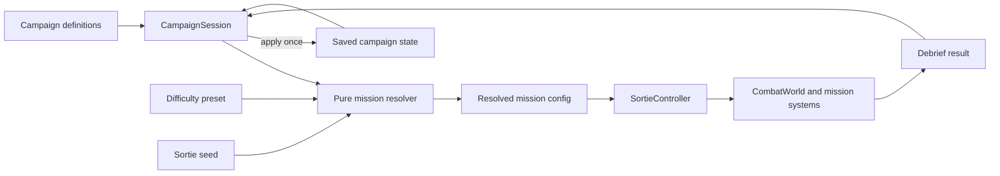

# Campaign design: Shadow at the Border / Rajan varjo

Status: campaign foundation and the sorties 1, 2, and 6 vertical slice are implemented; remaining operational objectives and final balance remain planned.

This document defines the first Ilmatila campaign layer. The ten-chapter
sequence, persistent state, deterministic mission resolution, menu view, and
accept/retry loop are implemented. Unknown Track, Broken Silence, and The Border
Breaks use their campaign-specific objective rules; the other playable chapters
reuse Patrol, Intercept, and Support rules. Later sections describe the remaining
campaign-specific objectives, content, and tuning.

## Design goals

The campaign should make the existing sorties feel like connected operations
in a changing war. Its military context should be believable while flight,
weapons, recovery, and mission length remain deliberately arcade-oriented.

The campaign has five priorities:

1. Escalation must be visible. The player starts by identifying an ambiguous
   airspace violation and ends by supporting a counterattack against an invasion.
2. Every sortie must pose one clear operational problem. Radio, radar, and the
   briefing explain what matters before competing threats arrive.
3. Results must affect later sorties without creating an unwinnable downward
   spiral. Campaign state changes the pressure and presentation, not the core
   ability to fly and fight.
4. Easy should let a first-time player see the whole story with little friction.
   Hard should demand threat prioritization, wingman orders, fuel discipline,
   and acceptance of imperfect results.
5. Military plausibility should come from rules of engagement, target roles,
   force purpose, timing, and consequences. It should not come from long transit
   flights, exact real-world procedures, or opaque simulation.

The scenario is fiction. It uses public geography and broadly known defensive
concepts, but it must not claim to depict an actual Finnish or NATO plan. Unit
names, installations, response times, and tactical dispositions are invented.
The aggressor remains unnamed in campaign text. Existing aircraft and vehicle
models represent capability classes rather than an exact order of battle.

## Scenario premise

The campaign takes place over ten operational days during an invented near-future
crisis. Virolahti is a credible opening location because it meets both the Gulf
of Finland and Finland's eastern border and includes the E18 corridor and
Vaalimaa. The game uses that geography as narrative context, not as a detailed
model of local defenses.

Tension has been rising around the Baltic. Navigation interference, cyber
incidents, and unusual exercises have raised readiness, but civilian traffic is
still moving and political leaders are trying to prevent escalation. Two
military aircraft then enter Finnish airspace near Virolahti without clearance.
The player is ordered to identify and escort them, not to fire merely because
they crossed the border.

One aircraft records Finnish reactions while the other probes the coastal
surveillance picture. They withdraw after being identified. Within hours,
jamming increases and a strike package tries to destroy the same surveillance
network. This hostile act resolves the ambiguity. Air attacks expand against
command links, road bases, and mobilizing ground forces while the aggressor
claims that Finland fired first.

The strikes are preparation for a land invasion on more than one axis. The
campaign's playable focus returns to Virolahti when armored forces cross near
Vaalimaa and drive west along the E18 corridor. Other fronts and allied actions
are heard through briefings and radio reports. The player protects dispersed air
operations, delays the spearhead, helps break its local air defenses and
logistics, and supports a Finnish counterattack that restores the border. The
campaign ends on Finnish territory; crossing the border to conduct a strategic
attack is outside its scope.

Finland's allies begin consultation and collective defense measures after the
opening attacks. Their help appears progressively as intelligence, air picture
support, replacement stores, and finally allied aircraft. This keeps the early
campaign centered on Finnish forces and avoids an implausible instant arrival
of a large allied force.

## Presentation of the wider war

Each terrain package is a tactical window into a conflict larger than its
32-by-32-kilometre playable area. A sortie begins close to the relevant action;
flight time between national regions is omitted. The four current terrain areas
can show different parts of the same campaign:

- Virolahti carries the incursion, first armed clash, invasion, and counterattack.
- Päijänne represents dispersed air operations and the protected logistics rear.
- Ilomantsi shows the diversionary eastern pressure that reveals the invasion's
  larger shape.
- Kuusamo hosts a northern interception that prevents a second breakthrough and
  buys time for allied support.

The strategic briefing map, news strip, and radio traffic describe events beyond
the current terrain. Background events may change campaign state through authored
story beats, but the game must distinguish those from consequences caused by the
player.

## Campaign structure

The first campaign is a fixed ten-sortie arc with soft branches. Every player
flies the same ten narrative chapters, while campaign state changes friendly
support, enemy composition, optional objectives, radio lines, and some target
locations. This gives choices consequences without multiplying the amount of
required mission content.

| # | Sortie | Area | Operational purpose | Primary play |
| --- | --- | --- | --- | --- |
| 1 | **Unknown Track / Tuntematon maali** | Virolahti | Establish identity and intent under peacetime rules of engagement | Intercept, identify, signal, and escort two intruders out |
| 2 | **Broken Silence / Hiljaisuus murtuu** | Virolahti | Protect the coastal air picture after jamming begins | Defend a fictional surveillance relay from Sweep and Strike aircraft |
| 3 | **Disperse / Hajautus** | Päijänne | Keep combat aircraft operating after attacks on fixed bases | Cover a road-base logistics movement while intercepting a strike wave |
| 4 | **Northern Feint / Pohjoinen harhautus** | Ilomantsi | Prevent a helicopter insertion and learn whether it is a diversion | Intercept helicopters before their landing window while fighters screen them |
| 5 | **First Wave / Ensimmäinen aalto** | Kuusamo | Stop a second axis from becoming a breakthrough | Defend a mobilizing ground formation from a timed multi-axis air attack |
| 6 | **The Border Breaks / Raja murtuu** | Virolahti | Blunt the armored force crossing near Vaalimaa | Close air support against the vanguard while protecting the defensive line |
| 7 | **Hold the E18 / Pidä E18** | Virolahti | Buy time for civilians and reserves to clear the corridor | Delay advancing columns for a fixed period and protect a friendly convoy |
| 8 | **Blind the Spear / Sokaise keihäänkärki** | Virolahti | Open a safe window for the counterattack | Destroy local air defense and the marked command or logistics relay |
| 9 | **Counterstroke / Vastaisku** | Virolahti | Help Finnish armor cut the spearhead from its support | Escort the friendly attack, suppress ground threats, and defeat enemy air cover |
| 10 | **The Border Holds / Raja pitää** | Virolahti | Collapse the remaining bridgehead and restore territorial control | Defeat the final air response, destroy the local command group, and extract |

### Act I: ambiguity, sorties 1-2

**Unknown Track** teaches campaign rules through a tense mission without a
mandatory battle. Contacts begin uncertain. The player must approach to visual
identification range, remain in an escort zone, and wait for authorization.
Weapons remain inhibited until a hostile act and weapons-free authorization. On
Easy, the correct contact and escort position are explicitly marked and the
intruders comply. On Hard, jamming
creates intermittent tracks, the aircraft split, and one makes an aggressive but
non-firing turn. Required information remains available; difficulty comes from
flying and judging the situation under pressure.

A clean identification produces the `intruders-profiled` intelligence flag. It
reveals the Strike element and its likely approach in sortie 2. Losing contact
does not end the campaign; it makes the next briefing less precise and advances
the hostile arrival.

**Broken Silence** is the first combat sortie. A Sweep element tries to occupy
the player and wingmen while Strike aircraft route toward a fictional relay.
The primary objective is to keep the relay operational until the attackers are
destroyed or driven away. Air kills alone are insufficient if the Strike element
reaches the site. The transition from identification to combat is announced by a
clear hostile act and weapons-free radio call.

### Act II: survive the opening blow, sorties 3-5

**Disperse** turns Finland's publicly known use of dispersed road operations into
an arcade defense mission. A friendly ground convoy represents fuel, weapons,
and maintenance crews moving to a road base. The player fights above it rather
than performing takeoff or landing procedures. Saving the convoy improves
readiness; losses reduce later bonus stores but never take the player's minimum
combat loadout away.

**Northern Feint** introduces a target that must be stopped before completing an
action. Helicopters head toward a visible landing zone while fighters screen the
route. Surviving helicopters that reach the zone withdraw from the local battle
and count as landed. Destroying the insertion force reveals the main ground axis
and grants the `main-axis-confirmed` flag. Failure adds a small hostile ground
detachment to sortie 5 instead of creating a separate mission branch.

**First Wave** is the act's air-combat climax. Two hostile groups approach a
friendly formation from different bearings. The player cannot intercept both
alone and must use wingman orders. Allied intelligence is present in the
briefing if the earlier reconnaissance objectives succeeded. This sortie ends
with confirmation that armored forces have crossed the border near Vaalimaa.

### Act III: invasion, sorties 6-8

**The Border Breaks** uses the current Support battle as its base. Hostile armor,
air defense, helicopters, and a limited fighter screen support the vanguard.
The primary objective becomes destroying enough assault strength to stabilize
the friendly line, rather than eliminating every truck and vehicle. Logistics
and air-defense targets have explicit battlefield roles.

**Hold the E18** is a delay mission. A visible timer represents evacuation and
reserve movement. Destroying lead vehicles, bridges represented by authored
choke-point triggers, or the logistics relay slows the assault. The objective is
fulfilled when the timer expires with at least the required friendly force and
convoy strength. The player may then disengage and extract even if enemies remain.
This is important to the campaign tone: operational success does not require
annihilating every unit on the map.

**Blind the Spear** is a compact suppression mission. The player chooses through
target order whether to destroy air defense first, command first, or risk a fast
attack on logistics. Destroying the marked relay before its warning cancels one
fighter reinforcement, reusing the current Support encounter rule. The surviving
target category modifies sortie 9: air defense makes low attacks more dangerous,
command improves enemy coordination, and logistics adds armor.

### Act IV: counterattack, sorties 9-10

**Counterstroke** reverses the pressure. Friendly armor advances and the player
must keep it moving while Sweep aircraft attack the flight and Strike aircraft
attack the column. Allied aircraft can replace one lost Finnish wingman if allied
support was secured, but they use the same wingman command model. The mission is
won by getting enough friendly combat power through the objective zone.

**The Border Holds** combines the campaign's learned skills without becoming an
unbroken enemy swarm. The battle has three announced phases: air cover, local
command group, and final hostile response. Surviving threats carry between
phases, but the pressure director provides short reorganization windows. The
best ending requires mission success and a viable defense state. A basic victory
only requires collapsing the bridgehead and extracting.

## Rules of engagement and readable escalation

The opening mission needs an explicit contact disposition separate from team:

- `unknown`: visible as an uncertain return and not weapon-selectable;
- `identified-neutral`: selectable for inspection or escort, but weapon release
  is inhibited;
- `hostile`: targetable after an observed hostile act or authorization event;
- `departing`: tracked until it exits, with weapons held unless it re-engages.

The HUD should state `IDENTIFY`, `ESCORT`, `WEAPONS HOLD`, or `WEAPONS FREE` near
the selected contact. An attempted prohibited launch produces feedback and no
shot. Cannon input is also inhibited while the boresight intersects a protected
contact. This is a game rule, not a simulation of every legal or command detail.

Later sorties preserve the current readable threat sequence: detection,
identification, lock warning, launch, and inbound warning. Hard can overlap at
most two immediate complications, but it must not remove warnings, spawn a
missile already in terminal range, or hide information required to understand a
failure.

## Campaign state

The campaign stores three visible values from 0 to 100 and a small set of
authored flags:

| State | Meaning | Later effects |
| --- | --- | --- |
| **Air control** | Ability to detect, intercept, and protect friendly movement | Contact warning time, friendly air support, hostile reinforcement timing |
| **Defense integrity** | Remaining combat power and cohesion of the local ground defense | Friendly unit count and health, delay thresholds, final ending |
| **Sortie readiness** | Fuel, weapons, maintenance, and road-base support available to the flight | Bonus stores, replacement wingman availability, recovery options |

Example flags include `intruders-profiled`, `relay-saved`,
`road-base-supplied`, `main-axis-confirmed`, `e18-held`, and
`local-air-defense-breached`. Flags select authored briefings and encounter
modifiers. They should never be queried through hidden global state; mission
resolution receives an immutable campaign snapshot.

Each sortie result is graded strategically as one of:

- **Decisive success:** primary objective and its campaign-critical secondary
  condition completed;
- **Success:** primary objective completed;
- **Setback:** player extracted but the primary objective failed;
- **Lost aircraft:** player was destroyed and the sortie must be retried;
- **Aborted:** result is not committed.

Only an accepted debrief result updates campaign state. Applying a result must be
idempotent through a unique sortie attempt id. Retrying uses the pre-sortie
snapshot and the same seed so the player can learn a difficult engagement. A
retry count may affect a campaign medal but never combat balance. An optional
Iron campaign can be considered later; it is not part of the first version.

State changes have protected floors. A poor campaign may remove bonus stores,
reduce friendly support, or advance a hostile warning, but every mission still
provides the minimum weapons and forces needed to complete its primary objective.
This prevents one failure from turning the remaining campaign into cleanup of an
unrecoverable state.

### End states

- **Border secured:** sortie 10 succeeds and Defense integrity is at least 60.
- **Invasion contained:** sortie 10 succeeds with lower Defense integrity, or
  the bridgehead is isolated after an otherwise mixed campaign.
- **Unresolved front:** the player extracts from sortie 10 but its primary
  objective fails. The campaign records the ending and offers the final sortie
  for replay.

The player never receives a conquest ending. The strategic objective is to
restore Finnish territorial control and preserve the force.

## Difficulty design

Difficulty is selected from the campaign menu and remains fixed for the active
sortie. Returning to the campaign menu allows switching between the independent
Easy, Standard, and Hard saves. The story and core objectives remain the same so
difficulty records are comparable.

| Dimension | Easy | Standard | Hard |
| --- | --- | --- | --- |
| Intended result | Story can be completed on a first run | Current Ilmatila baseline with recoverable mistakes | Success requires good flying, prioritization, and commands |
| Hostile force scale | About 60-70% of Standard; no surprise reinforcements during recovery | Authored baseline | About 120-135%; added units serve distinct roles rather than forming one blob |
| Immediate complications | One; the next waits for a clear recovery window | One, with shorter recovery windows | Up to two, announced and normally separated by at least three seconds |
| Player resilience | High hull, low incoming damage, and one weapon-hit grace per sortie | Current baseline | Lower hull and greater incoming damage; no grace |
| Stores | Generous air and ground missiles, unlimited cannon, unlimited fuel | Baseline stores and a forgiving tactical fuel budget | Six or fewer missiles per role where mission-feasible, limited cannon and a meaningful tactical fuel budget |
| Enemy reaction | Long detection/reaction delay, poor coordination, rare second countermeasure attempt | Baseline | Fast reaction, coordinated Sweep/Strike tasks, energy-aware focus, disciplined countermeasures |
| Wingmen | Durable, accurate, proactive, and quick to obey | Baseline | Useful but unable to win the mission unattended; orders are essential |
| Objective tolerance | Low protected-force threshold, generous timers, full route and target prompts | Authored baseline | Higher survival thresholds, tighter timers, fewer predictive prompts |
| Campaign penalties | Half-sized and clamped to generous state floors | Baseline | Full effect, while completion-critical resources retain a minimum floor |

### Easy: deliberately forgiving

Easy should feel like an action film. A hostile missile hit should be a warning,
not usually a sortie-ending event. The first otherwise lethal weapon hit in a
sortie leaves the player at a safe hull floor and triggers a clear emergency
message; terrain, boundary, and direct vehicle collisions remain lethal. Hostile
fighters attack in readable pairs, rarely evade twice, and do not coordinate
focus fire. Friendly ground forces start stronger and wingmen can defeat ordinary
contacts without constant management.

Easy mission timers should include at least 50% more margin than the measured
median Standard completion time. Campaign-critical targets remain highlighted
and radio repeats a missed instruction. Fuel is unlimited. Optional objectives
reward mastery but never add a penalty. A player who understands target selection,
missile launch, countermeasures, and extraction should be able to finish the
campaign.

### Standard: intended first full experience

Standard retains the current one-complication pacing and existing weapon and
countermeasure economy. Campaign missions add role-based pressure, but a player
may recover from one poor engagement or misunderstood priority. Fuel should be a
tactical constraint only on prolonged use of afterburner; the current multi-hour
reserve must be retuned before it can serve this purpose in a short sortie.

### Hard: difficult through decisions

Hard should avoid relying mainly on extra hit points. Hostile aircraft may have
only a modest durability bonus, but they coordinate roles: Sweep fighters pin
the player or wingmen, Strike aircraft continue toward the operational target,
and helicopters exploit low-level routes. Ground air defense covers likely attack
axes and surviving command targets shorten reinforcement delays.

Hard permits two hostile missile commitments when they come from distinct
attackers or domains. The second commitment receives its full lock warning and
should normally start at least three seconds after the first. A reinforcement
warning may run during another complication, but the response must not spawn
inside immediate weapon range. This breaks the current single-pressure ceiling
without turning the HUD into noise.

Hard fuel should be tuned to roughly 18-22 minutes of normal flight for a sortie
whose expected completion time is 10-14 minutes, with afterburner retaining its
high consumption multiplier. Standard should have roughly twice that tactical
margin and Easy remains unlimited. These are gameplay budgets rather than claims
about real aircraft endurance.

Hard objectives demand preservation as well as kills. A technically surviving
friendly line may be insufficient if too much combat power is lost, and delay
missions leave less time to correct a poor target choice. Required targets,
weapons-free changes, missile launches, and extraction routes remain explicit.
Difficulty must never depend on withholding the information needed to act.

## Balance targets and playtest evidence

The words Easy and Hard need measurable targets. After controls have been learned,
campaign playtests should aim for:

| Measure | Easy target | Standard target | Hard target |
| --- | --- | --- | --- |
| First-attempt sortie completion | 90% or higher | 60-75% | 20-35% |
| Campaign completion without changing difficulty | 85% or higher | 50-65% | 10-25% |
| Median hull on a successful combat sortie | Above 60% | 35-65% | Below 40% |
| Mission failures judged understandable by tester | 95% or higher | 95% or higher | 90% or higher |

These are tuning goals, not automated test assertions. Record per-sortie cause of
failure, time to first hostile shot, hostile missile commitments, countermeasure
use, wingman orders, fuel state, protected-force losses, objective phase times,
and retries. Do not change several balance dimensions from one playtest build to
the next; otherwise the cause of an improvement cannot be identified.

## Mission mechanics required

The current `clearAir`, `support`, and `training` objectives cover parts of the
campaign. The following reusable mechanics are needed for the full arc:

1. **Identify and escort:** distance and dwell-time identification, contact
   disposition, weapons hold, escort corridor, and departure completion.
2. **Defend an asset:** a friendly site or unit group survives until attackers
   are defeated, driven off, or a timer ends.
3. **Prevent an action:** an aircraft or ground group fails if it reaches a
   landing, strike, or breakthrough zone before being stopped.
4. **Delay:** mission success depends on time and remaining friendly strength;
   hostile survivors are allowed.
5. **Advance and escort:** friendly ground forces must reach an objective zone
   with a configured minimum strength.
6. **Phased objective:** authored phases activate in order and provide a short
   pressure-recovery window without resetting surviving units.

These should be data-configured objective components rather than campaign-specific
conditionals in `CombatWorld`. Optional-objective selectors already provide a
useful model for referring to units by collection and role.

## Proposed ownership and data flow

The campaign layer should sit above a sortie. It owns narrative progression and
persistent strategic state; it does not own combat units, projectiles, terrain,
or per-frame updates.

Suggested modules are:

- `src/campaign/campaigns.js`: authored chapters, transitions, state effects,
  briefing keys, and permitted mission modifiers;
- `src/campaign/campaign-session.js`: active campaign lifecycle and idempotent
  application of accepted debrief results;
- `src/campaign/campaign-progress.js`: versioned, tolerant local persistence,
  separate from existing sortie records;
- `src/campaign/resolve-campaign-mission.js`: pure combination of chapter,
  campaign snapshot, difficulty, and seed into a normal mission definition;
- `src/ui/campaign-view.js`: theater timeline, state meters, chapter briefing,
  result preview, continue, and retry actions.

`main.js` remains the page composition root and switches between standalone
sortie selection and campaign presentation. It asks the campaign session for a
resolved mission, then passes that mission into `SortieController`. The controller
continues to own preparation, cancellation, start, pause, finish, and disposal.
It should accept an explicit resolved mission definition instead of looking up
all campaign missions in the standalone `MISSIONS` table.

`CombatWorld` remains unaware of the persistent campaign. It receives one
resolved mission definition and returns a richer debrief result. `MissionSystem`
owns the primary objective components; `MissionFlowSystem` continues to own
phase, routing, and extraction. `EncounterDirector` remains the owner of authored
reinforcement timing and should gain a difficulty-provided complication budget
rather than receiving campaign checks.

Campaign persistence should use a new versioned storage key. A save contains
campaign id, schema version, selected difficulty, current chapter, the three visible
state values, authored flags, accepted attempt ids, current sortie seed, retry
count, and ending. Loading must clamp numeric state, ignore unknown flags, and
fall back safely when storage is unavailable. Existing `CareerProgress` and its
standalone mission unlocks remain intact.

## Mission configuration

Campaign chapters should reuse mission definitions instead of copying current
difficulty values into content. A resolved chapter may specify:

- objective components and success thresholds;
- air and ground force roles and counts;
- encounter plan and campaign-state conditions;
- fixed theater and route geometry;
- briefing, radio, and debrief keys;
- explicit difficulty deltas such as force scale, time threshold, or friendly
  strength requirement;
- strategic effects for decisive success, success, and setback.

Numeric combat behavior remains in `src/combat/difficulty.js`. Mission-specific
counts and timers remain in mission or campaign data. `validateGameConfig` must
validate campaign definitions and reject unknown modifier fields. Resolution
must be deterministic: campaign variant and encounter selection use seed-derived
streams that do not consume combat RNG.

## User flow

The main menu gains **Campaign** and keeps **Standalone Sortie**. Starting a
campaign selects difficulty, creates a save, and opens the campaign situation
view. The view shows the current day, chapter, three state meters, a short news
report, briefing, expected threats, and the consequences at stake. It does not
show exact hidden encounter rolls.

After a sortie, the existing tactical debrief appears first. A campaign panel
then previews state changes and explains them in plain language, for example
`Road-base convoy saved: Readiness +12`. The player chooses either **Accept and
continue** or **Retry sortie**. Lost-aircraft and aborted results do not offer
acceptance. Completing the campaign preserves the final state and best campaign
score per difficulty.

## Implementation sequence

### 1. Campaign foundation

- Add validated campaign definitions, pure state transitions, versioned storage,
  deterministic mission resolution, and focused unit tests.
- Change `SortieController.prepare()` to accept a resolved mission while
  preserving standalone mission lookup at the caller.
- Add the campaign menu shell, state view, debrief preview, accept/retry flow,
  and lifecycle integration tests.
- Use current `patrol`, `intercept`, and `support` rules for temporary chapters so
  the full save/launch/debrief loop is testable before new objectives arrive.

### 2. Vertical slice: sorties 1, 2, and 6

- Implement contact disposition, identification, weapons hold, escort, and
  asset-defense objectives for Unknown Track and Broken Silence.
- Adapt Support into The Border Breaks with a strength threshold instead of a
  kill-everything condition.
- Implement campaign effects across these three sorties and test Easy, Standard,
  and Hard end to end. This slice proves the escalation, air-only gameplay,
  ground battle, and persistent consequences.

### 3. Reusable operational objectives

- Add prevent-action zones, delay, convoy survival, friendly advance, and phased
  objectives.
- Extend role-based radio and HUD presentation so the priority target and reason
  are visible.
- Add campaign-state modifiers to mission resolution, keeping combat systems
  independent of persistence.

### 4. Complete the ten-sortie content

- Author the remaining chapters, variants, soft-branch changes, localized
  briefing/radio/debrief text, and menu radar previews.
- Add new visual assets only when an existing aircraft, helicopter, vehicle, or
  abstract site marker cannot communicate the role.
- Keep each sortie's expected active play time around 8-15 minutes.

### 5. Difficulty and campaign tuning

- Move the threat-pacing concurrency limit into difficulty data.
- Give Easy its weapon-hit grace, generous objective thresholds, and campaign
  consequence clamps.
- Retune Standard and Hard fuel into tactical sortie budgets.
- Tune Hard through role coordination, overlapping pressure, target thresholds,
  and resource limits before increasing health or damage.
- Run repeatable seeded playtests and adjust against the balance targets above.

### 6. Polish and release validation

- Add ending scenes, campaign records, accessibility review, diagnostics context,
  and recovery from corrupt or old saves.
- Run lifecycle, deterministic resolution, storage, objective, configuration,
  integration, browser, performance, and localization checks.
- Update the current architecture, game design, testing guide, and README only
  when the implemented behavior makes their existing statements obsolete.

## Definition of done for the first campaign

- All ten chapters can be completed in sequence on each difficulty and resume
  correctly after a page reload.
- A setback changes later content but cannot remove completion-critical resources.
- Unknown Track can be completed without firing, and an unauthorized shot is
  inhibited and explained.
- Easy meets its completion targets with new players who know the controls.
- Hard produces materially more failed objectives and retries through coordinated,
  readable pressure rather than hidden attacks or large health multipliers.
- Every hostile weapon still follows the established warning sequence.
- Retrying reproduces the same resolved encounter and does not apply campaign
  effects twice.
- Standalone missions, records, resource ownership, cancellation, and repeated
  launch/dispose cycles continue to work.
- English and Finnish campaign text cover the same keys and communicate the
  objective, rules of engagement, and consequences consistently.

## Public realism references

The scenario uses only broad public facts as grounding:

- [Virolahti municipality: location](https://virolahti.fi/tietoa-virolahdesta/sijainti/)
  describes the municipality's border, Gulf of Finland, Vaalimaa, and E18 setting.
- [Finnish Ministry of Defence: suspected airspace violation over the Gulf of Finland, 23 May 2025](https://www.defmin.fi/ajankohtaista/tiedotteet_ja_uutiset/epailty_ilmatilaloukkaus_suomenlahdella.15045.news)
  is a public example of an alleged violation being treated seriously and
  investigated rather than automatically presented as a combat event.
- [Finnish Air Force F/A-18 fact sheet](https://ilmavoimat.fi/documents/1951206/2016308/Finnish%2BAir%2BForce%2BFact%2BSheet%2B-%2BFA-18CD%2BHornet%2B%28JAN%2B18%29.pdf/6eb2f056-12a1-4182-ae1a-3705e8a25b47/Finnish%2BAir%2BForce%2BFact%2BSheet%2B-%2BFA-18CD%2BHornet%2B%28JAN%2B18%29.pdf)
  publicly describes air-policing, defensive counter-air, joint support, and
  dispersed highway-strip operations.
- [NATO: collective defence and Article 5](https://www.nato.int/en/what-we-do/introduction-to-nato/collective-defence-and-article-5)
  provides the political basis for allied collective-defense measures after an
  armed attack. The campaign's exact allied response remains fictional.

